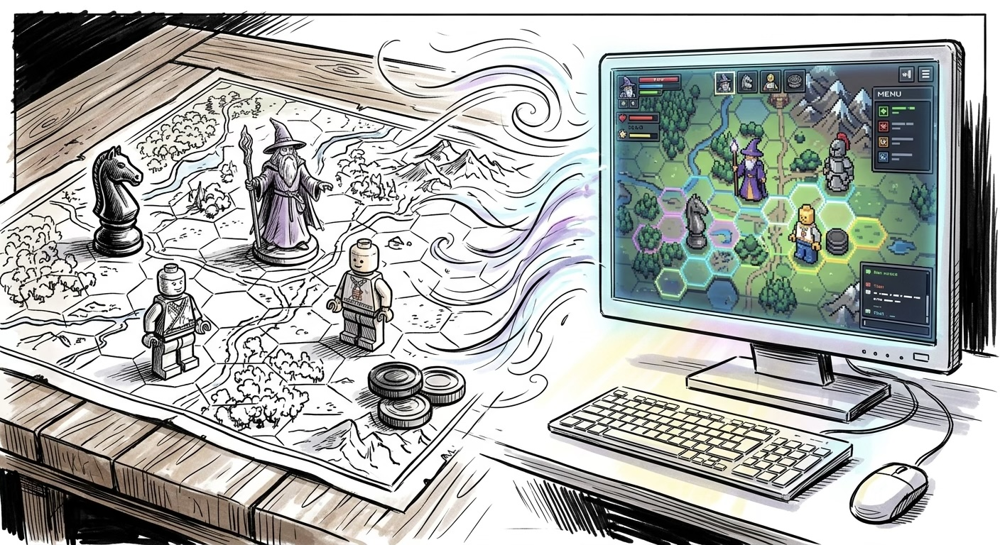
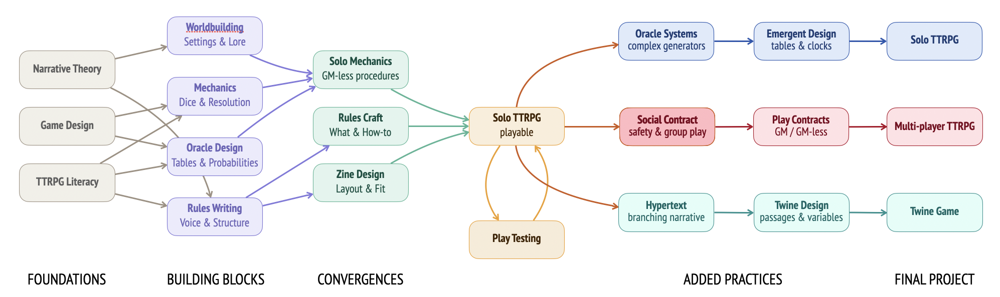

# Story Games
ENGL 370-002 / TuTh 12:30-13:45 / HLG 320  
Pr. John Laudun / HLG 356 / laudun@louisiana.edu

## Description

Branching narratives, interactive fiction, text adventures, CYOA (Choose Your Own Adventure) all describe a form of entertainment--be it literary, performed in a group, or in a video game--in which a user is given choices and their choices determine the nature and outcome of the story. This course considers the history of narrative games, from collaborative storytelling in oral cultures to the robust open-world games to cinematic universes in which multiple storylines exist (and sometimes interact). 

Course inputs include reading analytical--game studies!--and practical essays as well as viewing analytical and practical videos--(warning: these can be long), and of course playing games of various kinds. 

Course outputs include several short analytical essays as well as the development of a solo TTRPG by mid-semester which can be revised or expanded into a multi-player TTRPG or turned into a sketch for a video game as a final project. 

## Objectives

This course aims to provide participants with the necessary tools and skills to analyze and to create story/narrative games. To do this, participants will need to master: foundational concepts in narrative and game design, experiment with a variety of game mechanics, engage others collaboratively (and occasionally competitively), document their work both individually and collectively, and be able to present their work to an audience. 

We start with TTRPGs because they require clear and effective writing. For those more interested in video games, TTRPGs are a good place place to experiment with game mechanics. (See this [2023 GDC talk](https://www.youtube.com/watch?v=6sXdCKd0XdE).) Everyone builds a solo TTRPG. Everyone.

## Course Materials

### Textbook

For this iteration of the course, we will be using Skaff et al's *Characteristics of Games*. For those interested in video games, Heussner et al's *The Game Narrative Toolbox* offers a lot of practical advice and has previously been the textbook for this course. The short of it is this: this is an upper-division course: you will be reading. Buy the book; read the material. Come ready to discuss--as well as to operationalize!

Elias, George Skaff, Richard Garfield, and K. Robert Gutschera. 2012. *Characteristics of Games*. MIT Press.

Heussner, Tobias, Toiya Kristen Finley, Jennifer Brandes Hepler, and Ann Lemay. 2023. *The Game Narrative Toolbox*. Focal Press Game Design Workshops.

In addition to the textbook, there are a variety of readings  online, including via portals like JSTOR, or under the files tab in our Teams instance.

Finally, make sure you check out the [Resources](./resources.md) page. There is a lot of useful links there. (And more links are welcome!)

### Hardware

In addition to the textbook, there is also a list of materials: 

* **Dice**: Participants will need a set of die that includes several D6 and at least one each of D8, D12, and D20 (more is better but not required). 16mm and 19mm dies are more adult human friendly, but functionality matters more than size.
* **3 x 5 cards**: We will be prototyping, and trialing, first physical and, perhaps later, virtual narrative game forms. Participants need to be able to generate both. While there are pre-cut square and hexagonal game tiles of various sizes, blank playing cards, and a myriad other ready-made materials, access, and willingness to use one's imagination, cardstock and cardboard are the only things required. (An awful lot can be achieved with 3 x 5 cards.) *And, yes, effective, and compelling, game figures can be created out of cardboard cutouts and markers.* 
* **Markers & Scissors**: In order to create the cards, tiles, and boards from a variety of materials, participants will also need to have scissors or other cutting implements -- please exercise caution and remember to use a cutting mat when working -- as well as markers or painting supplies.

### Software

* We will be using network graphs to represent interactive fictions and narrative games. This can be done entirely with note cards, by the way, but you can also create simple diagrams in presentation software like PowerPoint or Keynote. Anything more than a few nodes high/deep quickly becomes about managing readability and not about generating ideas. There are a variety of mind-mapping, as well as diagramming, applications available. Feel free to familiarize yourself with one but you can do an awful lot with [Twine](https://twinery.org). See Resources > Software for more.
* In addition to these physical materials, participants will of course need access to a computer and software. The university provides a license to Office 365. Use of Teams is mandatory, and you might as well use the other apps as well. There is a fair amount of writing in this course, much of it structured, and so familiarity with Word's outline capabilities and the relationship between outline headings and styles is *strongly* recommended. (We will discuss this in class, but you should start familiarizing yourself with this stuff now: your life will be so much easier for it.) PowerPoint can be an interesting platform for interactive fiction with its ability to have clickable links between non-sequential slides, and Excel can be pressed into service as a kind of database or project outline and/or Gantt chart. (If you use the equivalent software elsewhere, familiarize yourself with export options to Office file formats -- I prefer Keynote to PowerPoint, but there is no Keynote option on the classroom computer.)

## Assignments & Grading

It should be noted upfront that the essential sequence of this course is the design and manufacture of a solo TTRPG for the mid-semester project, with the chance to refine it, expand it to a multi-player TTRPG, or convert it to a pseudo-video RPG (using Twine) as the final project.

More than anything, this course expects and requires that participants be open to new ideas and different kinds of course experiences. This course was first offered in 2024, and it remains exploratory in many ways, always seeking to answer the question: what do participants need to know to think more clearly about stories and games and the media within which the two combine?

**Participation** (20%) includes all group activities as well as contribution to in- and out-of-class discussions.

**Assignments** (20%). There are a number of small assignments in this course: in-class activities, quickfire writing, analytical essays, design journals. (This is an English class, of course there is writing. Of course!) Some of the assignments are about developing your overall knowledge of games and narrative, and some are focused on you developing your own game(s). In all cases, this course is about ideation, planning, and execution at a high level thanks to drafting and revision; it is not about surprises and last-minute deadline screeching. *You have been warned.*

**Midterm (Solo) TTRPG** (30%). Table-Top Role-Playing Games are a great way to “see” the mechanics that underlie computer games and other automated systems. In addition to the rules set which is an outcome of the process, you are expected to keep a project logbook where you document the process itself—if you aren’t having a conversation with yourself, what are you doing? While the rules set will be shared with all participants, the process document, the logbook, is only for your eyes and those of the instructor. 

**Final RPG** (30%): Video games are what most people think about if they don’t think about *Dungeons and Dragons* first. As our textbook makes clear, most video RPGs are created by teams for a reason: there’s a lot to the end product. Here, we are prototyping a game, using Twine as the basis: there is a surprising amount of functionality under its hood and it keeps you focused on the essentials of good narrative game design: the critical path and the choices you present the player.

This course has no exams: it is focused on individual and group productivity. If you need an exam to motivate you to learn or to work, this course is not for you. 

## The Small Print

There is a common set of guidelines/requirements on how to be a participant in a course I facilitate. Read [The Essentials](https://johnlaudun.net/teaching/guides/essentials.md). That note is part of a collections of notes I have compiled over the years in response to common questions and needs. Please consult those [guides](https://johnlaudun.net/teaching/guides/) to see if your question already has an answer. (In all cases, my answer there will be better.) 

There is an AI policy for this course, and it is quite simple: if you feel the need to use AI to produce user-facing materials for this course, then this course is not for you. This class assumes that the participants are committed to their own growth in understanding and practice. Period. If you would like to use an AI to help you think through probabilities and mechanics, you may do so, but you must make that clear in your project notes. Failure to disclose the use of AI will result in a failure of the assignment at the very least. 

## Agenda

Please note that this course follows an agenda, not a schedule. The actual timing of discussions will be determined by the interest, experience, and expertise in the room. Some topics will expand; others will contract. If you are unsure about the date for a particular reading or discussion or assignment, first check *Teams* to see if an update has been posted and then check with a classmate.

Like any good resource management game, this course has an underlying skill tree which is overly ambitious. The agenda follows the skill tree, more or less.

There are a lot of links below. The goal is to give you a wide spectrum of materials in hopes that you will find those that speak to you and move your thinking, and your writing/crafting, forward. To be sure, there are a lot of websites and writers out there, all with good insights. This particular sample is representative but not comprehensive: please feel free to add! 

### Week 2

For Tuesday, **September 1**: print and read “The Most Dangerous Game.” (Print it; read it; mark it for characters, for plot points, for locations.) I highly encourage you to watch the [**1932 film adaptation**](https://www.youtube.com/watch?v=_DXLTw22HOQ), the first of many many may — you know the plot of this story without knowing the story because it has been adapted so many times. Considering other adaptations, or at least one, is one way to get yourself thinking about how you might adapt the story. (And if you aren't thinking, why are you in college?) Bring the printed copy — I would just put all your notes on the copy — and come prepared to discuss and then brainstorm adaptations. 

A PDF of the short story is available under the **Shared** tab above. (It will eventually be moved to a **readings** folder.)

As you work on game adaptations, there are additional resources:

- Wikipedia [**page for the original story**](https://en.wikipedia.org/wiki/The_Most_Dangerous_Game).
- Wikipedia’s [**list of adaptations**](https://en.wikipedia.org/wiki/Adaptations_of_The_Most_Dangerous_Game).
- The [**1932 film adaptation**](https://archive.org/details/TheMostDangerousGame) on Archive.org. (Same film as above.)

### Week 3

This week we begin what will be a semester-long discussion about the relationship between narrative and games. Tuesday's discussion will cover the preliminaries and some of the dimensions observers have already noted as well begin to sketch out one way to think about both narrative and game **logics**. 

The observant among you will have noticed that the **readings** folder has begun to be populated. I will be drawing upon a number of these this week, and I will expect you to have read them by week's end. (Random quizzes are always possible.) 

Many of the essays currentlin in the **readings** folder are drawn from the internet—most will have links back to the original, where much of the practical advice about designing and playing TTRPGs lives. While we begin there, we will over the weeks ahead draw upon scholarship on narrative and games. Be prepared for serious reading!

Choose a solo TTRPG to purchase and review. (Review will be due September 15: 350 words.)

The place I start my shopping is usually [**Itch.io**](https://itch.io/). There are a wide variety of genres, topics, and price points (and a lot of games are free). A lot of indie game developers, which means a lot of small games and a wide variety of games. If you type in "solo" in the search bar, Solo RPG will auto-fill — but also note there are other categories that might be worth exploring. 

- After Itch.io, I will look in [**DriveThruRPG**](https://www.drivethrurpg.com/en/)—for my TCG players/designers, there is a sister site, [**DrivethruCards**](https://www.drivethrucards.com/en/). You're welcome. 

Those two sites are pretty wide open, but there are also curated lists managed by other storefronts: 

- [**Tabletop Bookshelf**](https://tabletopbookshelf.com/) doesn't have as many games as Itch or DTRPG, but the games they offer are well-described and reasonably priced.
- [**Exalted Funeral**](https://www.exaltedfuneral.com/collections/solo-games) has a number of solo games—the link takes you to their solo collection, but feel free to look around. There are other solo games in other categories to be found.
- [**Etsy**](https://www.etsy.com/), believe it or not—and, honestly, I can't believe I just typed those four letters, has solo rpgs. Just search for **solo rpg**. 

Or by publishers, most of whom focus on multiplayer games but feature the occasional solo RPG. (Feel free to raid multiplayer games for ideas and mechanics!)

- [**Mongoose**](https://www.mongoosepublishing.com/) is largely known for being the publisher of Traveller, a game as old as Dungeons and Dragons, but they publish other RPGs.
- [**Modiphius**](https://modiphius.us/) is the publisher of the solo TTRPG that is currently getting a lot of attention, *Fallout: Wasteland Wanderer*—be forewarned, the price of the physical book is not for the faint of heart.

Or by individual game makers:

- We will be playing one of Toby Lancaster's games, 2D6 Dungeon. His storefront is [**DR Games**](https://drgames.co.uk/).
- I mentioned Anna Blackwell in class, and she has both a presence on [**Itch**](https://blackwellwriter.itch.io/) as well as her own storefront, [**Blackwell Games**](https://www.blackwellwriter.com/)—some of you may be excited to learn that she actually has a series of novels set in the world of one of her games. 

The 2026 ENNIE Award winners were announced on July 31 at Gen Con in Indianapolis. The winners and other nominees for Best Solo Game:

- **🥇**[***SPINE: A Dark Solo TTRPG About Losing Yourself in a Book***](https://www.backwardstabletop.com/spine/)*,* Backwards Tabletop
- **🥈**[***The Bonsai Diary***](https://stickydoodler.itch.io/the-bonsai-diary)*,* Sticky Doodler
- [***Odyssey of the Giant***](https://heltung-storytelling.itch.io/odyssey-of-the-giant) by Heltung Storytelling
- [***Pirouette***](https://innocentgoblin.itch.io/pirouette) *by* InnocentGoblin TTRPGs
- [***Song of the Scryptwyrm***](https://almostbedtimetheater.itch.io/sots) *by* Almost Bedtime Theater

Beyond games, the [**Solo RPG List**](https://solorpglist.com/) database and search engine won the Silver for **Best Online Content**.

You can see a list of all of the [**ENNIE nominees and winners here**](https://ennie-awards.com/2026-nominees/).

#### The Sandbox vs the Railroad

Last week, as we began our discussion of the tensions that run between **authored** texts versus **emergent** texts, we struck upon the fact that most of us have encountered a linear, or railroad, fiction. It's especially the case that most novels and movies are linear. Where the tension emerges is in games, where we often talk about open worlds or open world sandboxes or just sandboxes and also about linear stories or shooters-on-rails, likening the game to a roller coast ride where all the thrills and spills are defined ahead of the player's encounter and every player will encounter every thrill and spill at the same time. These two approaches are not an either/or but a continuum. 

Other people talking about this: 

- For those of you who are *Dimension 20* fans, Zac Pyama and Brennan Lee Mulligan discuss [**Railroading vs Sandboxing**](https://www.youtube.com/watch?v=LQ9tlq86bHw) as part of the "Adventuring Academy" series.
- Joseph Lewis in [**The Sandbox and the Story**](https://www.youtube.com/watch?v=sHsnmWjbUQg) explores the range of possibilities.
- Running the Game's [**The Sandbox vs the Railroad**](https://www.youtube.com/watch?v=EkXMxiAGUWg).

### Week 4: The Narrative Game Continuum (Phase 2)

This week we continue our discussion of narrative and games with a particular focus on decision mechanics. We are not discussing **when** in a fiction or game a player should be confronted with a decision but, rather, once they have been confronted, **how** will they make a decision. As always, there is no right or wrong answer but simply the mechanic which best suits the nature of the game you are making and/or the overall "feel" you want the game to have—of course, that feel should be tied to the nature of the game, so it all comes down to the game.

We are going to encounter a number of games this week. The one that the entire class will reference is *Cradle and Ward*, drawn from the 134 game packet available on *RPG Trader*. Each of you will receive a paper copy tomorrow that you will fold and staple into your first zine (booklet or folio). I include the PDF of Cradle and Ward here on Teams for those who want to get in a sneak peek.

#### More on Turns and Solo Play

First, watch this [short description](https://www.youtube.com/watch?v=yvzb3a9s0s0) (<5 minutes) of a combat turn in the multiplayer RPG *Mothership*: Oracle > resolution—note that the game master in *Mothership* is called a “warden.”

Now check out one or more of the following solo TTRPG play-throughs. (You can also search for them yourself and find a lot, a lot, more than what I have listed here.)

- [2D6 Dungeon](https://www.youtube.com/watch?v=yQNKxtQCINo&list=PLUktUzu0MmueLgkfhFRfhjGA0gvaOiwsp): this is the first of several episodes by the Tabletop Engineer, who does good quality play-throughs that are a half hour—this one is 20 minutes.
- [Four against Darkness](https://www.youtube.com/watch?v=AKbQySgm4Bc) is another play-through by the Tabletop Engineer (also about half an hour).
- [Notorious](https://www.youtube.com/watch?v=s4mAOcdpCJ8) is a bounty hunter game. In space. Warning: the creator, Cassi Mothwin, is trying out ASMR in this video. If that’s your jam, you’re welcome. If it’s not, it’s not all that ASMR-y to my ears.
- [The Hunter of Fort Vulgar: Solo Dolmenwood (Session 1)](https://www.youtube.com/watch?v=A6r5RDfEMMs) by Maia's Solo Room.

Really, watch any of the playthroughs of multiplayer games—most of them will be D&D—you find on YouTube to make sure you have the feel of a return.

- But if you need more solo TTRPGs to think about, check out DianaoftheRoses’ [Over 13 SOLO TTRPGs that Aren't Just Journals!](https://www.youtube.com/watch?v=kOl5FTrz7v4). Or Ginny Di’s [No D&D group? Try solo play!](https://www.youtube.com/watch?v=c2nVilB8QeY).
- If you’re interested in a game that keeps the mechanics to a minimum, focusing more on the oracle and less on resolution mechanics, take a look at this overview of [Loner RPG](https://www.youtube.com/watch?v=E8tG0LNsDE0).
- As a bonus, here’s Brennan Lee Mulligan appearing on *Talk Sh\*t* and explaining how to play D&D to Syd and Olivia in 15 minutes. It’s on [YouTube](https://www.youtube.com/watch?v=rD5AsIlvpwo).

### Week 6: 2D6 Dungeon

Character sheets and graph paper are available under the **Shared** tab in the **2D6 Dungeon** folder. I used [Incompetech](https://incompetech.com/graphpaper/#squaredots?width=8.5&height=11&page_units=inch&margin=0.9&margin_units=inch&weight=2&spacing=3&spacing_units=inch&gridColor=b3b3b3&bgColor=FFFFFF) to create the graph paper. (Click the link to make your own.) The character sheets are available both as single pages but also pre-formatted to print onto a single sheet of paper (double-sided) and the folded into a booklet.

FTR, the rules for 2D6 Dungeon are longer than most of those we have encountered so far: there's at least 25 pages or so (A5 sized pages to be sure) that you need to get through in order to have the basics of the game down. When I encounter rules like this, I will often look for a "playthrough" online so that I can ***see*** what the game looks like when it is played. If you search for "2D6 Dungeon playthrough" on YouTube for example, you will see a number of entries. 

One of those entries is by the Tabletop Engineer who has an entire [**playlist**](https://www.youtube.com/watch?v=yQNKxtQCINo&list=PLUktUzu0MmueLgkfhFRfhjGA0gvaOiwsp). (The game's designer, Toby Lancaster, also has a [**playthrough**](https://www.youtube.com/watch?v=HvtD_7cwyGo&pp=ygUXMmQ2IGR1bmdlb24gcGxheXRocm91Z2g%3D), but, as the game's designer, Toby is perhaps not your best guide.) 

During this week of play, I will be holding conferences with each of you at the front of the room. You get to show me your **game dev notebook** and talk me through your idea, or ideas, for a game. A quick reminder: the Tuesday before Fall Break you will be pitching your game to the class. You have two minutes and one slide to tell us about the game: its premise (what it's about), its approach to play (how it's played), and what you want players to "get out" of the game.

### Week 7: Game Pitches

The game pitch slide deck is now available under **Files/Shared**. In addition to the title slide, there is a sample slide. (And, yes, I used an AI to generate the image. For the purposes of this course, using AI to generate images is acceptable, so long as you indicate that in some fashion. It is not acceptable to use AI to write your rules—and, to be clear, I have explored this option and the language models I have tested generally don't know a lot about solo TTRPGs.)

### Week 8: Worlds & Characters

And, of course, the game loop. (Always the game loop.) I will, once the week is done, post the slides I am presenting this week. In the mean time, each and every one of you would benefit from reading both discussions about TTRPG games in general and solo TTRPGs in particular as well as reading rule sets of various kinds. Please note that there are two folders under the **Shared/Files** tab: the one called *readings* contains discussions; the one called *games* contains rule sets. (That's obvious enough, right?) 

A lot, a lot, of the *readings* focus on tables and oracles and game mechanics, because those are, in my experience, the non-obvious dimensions of solo TTRPGs. Those familiar with video games and TTRPGs with game masters are usually, not always!, less experienced with the mechanical aspects of a game. That's what the game master is for, right? And a computer game, *pffft*, you just pick up the controller and go. But if you look behind the screen of a video game, it's all about tables and lookups coupled with a random number generator whose output is modified by various stats that the game is maintaining for you. 

Better games, and their accompanying design document, demonstrate their awareness of the larger world of games, TTRPGs, and solo TTRPGs. What do I mean by better? Games that get assessed as *good* (Bs) or *excellent* (As). Games that are *fair* demonstrate that the person has been in class and done as little reading and thinking as possible in order to turn something in. (If that's your goal, fair play.) Ds and Fs happen, but they are rare because in most instances the people who stay to the end have decided to *do the work*. 

Okay, so the reading folder is there. For this week, take a look a Kosaro on performance—you can work out which one that is. And also read something, or things, from Angelina Trevina, whose substack I mentioned in class. For instance, take a look at:

- [A Worldbuilder's Starter Kit](https://angelinetrevena.substack.com/p/start-here-a-worldbuilders-starter) (It's more of a list of links, but in giving you summaries it gives you a decent idea of various dimensions of worldbuilding.)
- [What does your story need from its world?](https://angelinetrevena.substack.com/p/what-does-your-story-need-from-its) repeats or reinforces a number of things we discussed in class.
- Sadly, the essay on building a world around/from a trope is behind a paywall. (I'm a UL professor: I can't afford things behind paywalls. Sorry!)

For next week, read:

- Don't Write Lore, Write Tables
- Power of Resource Dice
- Structuring Resource Tables
- The Power of Choice Player

The games folder will be populated shortly. Patience, please!

### Week 9: Oracles & Mechanics

A few reminders:

1. First, a reminder: **bring your notebooks** to class on Tuesday. (I will be picking them up to see what you have been up to and returning them to you on Thursday.)
2. Second, **bring some dice**. All kinds. At least 2-3 D6 and it would be better if you have 2 each of d10 and d20. (d8s and d12s are welcome as well.) Also, bring something to roll the dice in, if you have it. If you have a **deck of cards**, bring it.
3. Third, with my apologies for the delay, I will be posting an assignment this afternoon that will contain your mid-term grade: you do not need to submit anything. It is simply the case that the only way I can disclose a grade to you from within Teams is by creating an assignment. If I can't make this work, then please feel free to ask me after class this week to see your mid-term grade. 

Links for today:

- [4 of the Most Common TTRPG Dice Systems](https://www.youtube.com/watch?v=nWNqWAyesvA)
- [Sixth Episode](https://www.youtube.com/watch?v=NYCyOe_8MPs) of Me, Myself, and Die's play-through of *Ironsworn*
- [Raven Ridge ad](https://www.youtube.com/shorts/eHP5nRRsrXU) defining solo play
